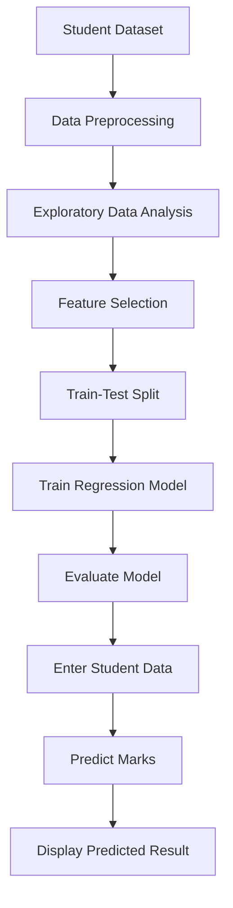

# 🎓 Student Marks Prediction Using Machine Learning

A machine learning project that predicts students' marks based on study-related data. The project demonstrates how regression techniques can be used to analyze learning patterns and estimate academic performance.

## 📌 Project Overview

The **Student Marks Prediction** project explores the relationship between students' study habits and their academic results.

By using historical student data, the model learns patterns between input features and marks, then estimates marks for new inputs. This project provides practical experience with data preprocessing, model training, prediction, and evaluation.

## ✨ Features

- 📊 Student data analysis and preprocessing
- 🧹 Data cleaning and preparation
- 🤖 Machine learning model training
- 📈 Marks prediction using regression
- 🔍 Analysis of relationships between study habits and academic performance
- 📉 Model evaluation and visualization
- 💻 Python-based implementation

## 🛠️ Technology Stack

- **Programming Language:** Python
- **Data Analysis:** Pandas, NumPy
- **Machine Learning:** Scikit-learn
- **Data Visualization:** Matplotlib, Seaborn
- **Development Environment:** Jupyter Notebook / VS Code

*Confirm the exact libraries and algorithm against your source code before publishing.*

## 🧠 How It Works

1. **Data Collection:** Load the student dataset.
2. **Data Pre
